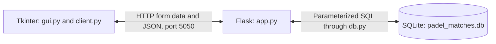

# Padel Match Planner

A Python desktop application for saving local padel matches and finding matches by city.

- **Student:** Taher Ramzi Taher Farhan Almaghrebi
- **Student ID:** 451000573
- **Course:** Advanced Programming 462
- **College:** College of Computer Science and Information Systems
- **Instructor:** Dr. Majed Hariri
- **Repository:** https://github.com/taher434/Padel-match-planner
- **Submission branch:** `revert-3-fix-vercel-postgres-migration`

## Features

- Add, view, edit, and delete matches through a Tkinter window.
- Filter matches by city, or use Show All to clear the filter.
- Select a row to populate the form; confirm before deleting a record.
- Save a match name, city, court, date, and skill level. SQLite generates the ID.
- Keep saved records after restarting the application.
- Show clear validation and connection errors, then retry in the same window.
- Export all saved matches to a UTF-8 text report using one worker thread.

## How the application connects



The GUI and report helper communicate with Flask automatically. All application database operations are in `db.py`, called by Flask. Each request opens its own connection when needed and closes it afterward.

## Setup on Windows with PowerShell

Install Git and a full Python 3.13 or 3.14 installation with pip and Tcl/Tk. Tested versions are Python 3.13.12 and 3.14.2. Python downloads are available from [Python.org](https://www.python.org/downloads/windows/).

If using GitHub, clone the submission branch and enter its folder:

```powershell
git clone --branch revert-3-fix-vercel-postgres-migration https://github.com/taher434/Padel-match-planner.git
cd Padel-match-planner
```

The repository is private. Accept an invitation or use an account with repository access before cloning. If using the Blackboard ZIP, extract it and open PowerShell in the extracted project folder instead.

Check Python, create an isolated environment, and install Flask:

```powershell
python --version
python -m venv .venv
.\.venv\Scripts\python.exe -m pip install -r requirements.txt
```

These commands use the environment's Python directly, so activating a PowerShell script is unnecessary. Python's [venv documentation](https://docs.python.org/3.13/library/venv.html) explains how the environment isolates packages.

Flask is the only third-party application dependency. Tkinter, SQLite, urllib, JSON, threading, and file handling come with Python. If `python` is not found, finish the Python installation and open a new terminal.

### VS Code and a missing Flask error

Open the whole project folder in VS Code and finish the environment setup above. The project's `.vscode/settings.json` points Code Runner's **Run Code** command to `.venv\Scripts\python.exe`. It also sets that path as the Python extension's default interpreter.

If `app.py` reports `ModuleNotFoundError: No module named 'flask'`, install the dependency using the same environment that runs the file:

```powershell
.\.venv\Scripts\python.exe -m pip install -r requirements.txt
```

For the Python extension's **Run Python File** command, use **Python: Select Interpreter** and select the project's `.venv` if another interpreter is already selected. Use the two terminal commands below to keep Flask and the GUI running together.

## Start Flask first

In the first terminal, from the project folder:

```powershell
.\.venv\Scripts\python.exe app.py
```

Flask runs at `http://127.0.0.1:5050`. Starting `app.py` automatically creates `padel_matches.db` and the matches table if missing. It preserves existing records; no separate table-setup command is needed.

Keep this terminal running. Ctrl+C stops Flask. If port 5050 is already occupied by another copy of this backend, use that running copy or stop it before launching another.

## Start the Tkinter window

Open a second terminal in the same project folder:

```powershell
.\.venv\Scripts\python.exe gui.py
```

1. Fill Match name, City, Court, Date, and Skill level, then click **Add Match**.
2. Select a table row, change its values, and click **Save Changes**.
3. Click **Delete Match** and confirm to remove only the selected record.
4. Use **New / Clear Form** to leave edit mode and add a new match.
5. Enter a city and click **Filter**, or press Enter. **Show All** clears the filter. **Refresh** reloads the current filter.

The GUI never asks for a server address. If Flask is unavailable, it displays a clear error and keeps entered values and displayed rows. Start Flask and retry using the same window. Requests use a five-second timeout.

The HTTP calls run in the GUI thread to keep the course code direct. The window can pause while a request waits for its timeout.

## Input rules

| Field | Rule |
| --- | --- |
| Name, city, court | Required, surrounding spaces removed, maximum 100 characters each |
| Date | Required, a real calendar date exactly in `YYYY-MM-DD` format |
| Skill level | `Beginner`, `Intermediate`, or `Advanced` |
| ID | Generated by SQLite; selected from the table |

Flask validates submitted values. Invalid input returns JSON with status 400. An unknown record returns JSON with status 404. The client reads those JSON error messages through `HTTPError`, caught before `URLError`.

The city filter trims surrounding spaces and ignores letter case for English city names. Arabic names are sent and saved as Unicode text.

## Write the threaded report

With Flask still running, use another terminal:

```powershell
.\.venv\Scripts\python.exe report_helper.py
```

The helper fetches `/matches/export`, starts one `threading.Thread` with `.start()`, writes the records with `with open(..., encoding="utf-8")`, and calls `.join()` before printing the result.

The report is saved to `reports/padel_matches_report.txt` beside the source files. It includes the total and every match's ID, name, city, court, date, and skill level. An empty database produces a report saying there are no saved matches.

A successful run replaces the previous report with a fresh snapshot. A failed HTTP request leaves an older report unchanged. Expected file errors produce a failure message. Exit status is 0 on success and 1 on failure.

## Course topics mapped to code

| Topic | File and function/class | What to explain |
| --- | --- | --- |
| Functions, conditions, loops | `app.py: validate_match`; `gui.py: PadelPlanner.refresh_matches` | Check each value and loop through saved records. |
| Lists and dictionaries | `db.py: MatchDatabase.get_matches`; `gui.py: PadelPlanner.read_form` | A list holds records; dictionaries give fields readable names. |
| Exceptions | `client.py: send_request`; `app.py: handle_database_error`; `report_helper.py: write_report` | Handle HTTP, connection, timeout, JSON, database, and expected file errors. |
| Classes | `db.py: MatchDatabase`; `gui.py: PadelPlanner` | One class owns a database connection; another groups GUI widgets and state. |
| SQLite | `db.py: create_table`, `add_match`, `get_matches`, `update_match`, `delete_match` | Use `?` parameters, commit writes, and preserve saved data. |
| Request connections | `app.py: get_database`, `close_database` | Flask `g` keeps one connection for a request; teardown closes it. |
| Threads | `report_helper.py: save_report` | Start one worker and wait with `.join()`. |
| Files | `report_helper.py: write_report` | Create the report directory, write UTF-8 text with `with`, and catch `OSError`. |
| Tkinter | `gui.py: PadelPlanner` | Inputs, table selection, buttons, city filter, and message dialogs. |
| Client and server | `client.py: send_request`; `app.py: add_match` | POST UTF-8 form bytes, receive JSON, and update the window. |
| Flask | `app.py: list_matches`, `export_matches`, `add_match`, `edit_match`, `delete_match` | Route GET/POST requests, validate form data, and return JSON/status codes. |

One complete Add action is: `PadelPlanner.add_match()` collects the form, `client.add_match()` sends it, Flask's `add_match()` validates it, `MatchDatabase.add_match()` saves it, and the GUI reads Flask's reply and refreshes the table.

## API routes

| Method | Route | Result |
| --- | --- | --- |
| GET | `/matches` | All saved matches |
| GET | `/matches?city=Riyadh` | Matches in one city |
| GET | `/matches/export` | All saved matches for the report helper |
| POST | `/matches/add` | Add form data; return 201 and the generated ID |
| POST | `/matches/<id>/edit` | Validate and update the selected match |
| POST | `/matches/<id>/delete` | Delete the selected match after GUI confirmation |

Success replies contain `success: true`. Failed requests contain `success: false` and `message`. List/export replies include `matches`. Incorrect methods return JSON 405; database failures return a clear JSON 500.

## Verification

Run the test suite from the project folder:

```powershell
.\.venv\Scripts\python.exe -m unittest discover -s tests -v
```

All **52 tests passed** on Windows with Python 3.13.12 and again with Python 3.14.2, using Flask 3.1.3 and Tkinter 8.6: 8 database, 13 API, 11 client, 12 GUI, and 8 report/thread/file tests.

Live integration checks also passed for complete record actions, city filtering, 400/404 errors, connection recovery in the same GUI, persistence after restarting both programs, UTF-8 reports, and report/file failures. Tests use temporary data. Simulated timeout/dialog checks are distinguished from live checks in [TEST_CHECKLIST.md](TEST_CHECKLIST.md).

Phase 5 verification repeated the setup in a clean copy: a new `.venv`, installation only from `requirements.txt`, all 52 tests, and the documented `app.py`, `gui.py`, and `report_helper.py` entry points. The copied application used its own database and report files.

## Project files

```text
app.py                     Flask routes and validation
db.py                      SQLite helper class and table setup
client.py                  Shared HTTP request functions
gui.py                     Tkinter window and callbacks
report_helper.py           One-thread UTF-8 report helper
requirements.txt           Flask dependency
.vscode/settings.json      Project interpreter and Code Runner configuration
tests/                     Automated tests
README.md                  Setup, behavior, and course-topic map
TEST_CHECKLIST.md          Results and repeatable checks
DEMO_GUIDE.md               Timed demo and code-understanding practice
SUBMISSION.md               Blackboard text and final submission steps
output/pdf/                 Presentation PDF
PROGRESS.md                 Project rules, phases, and completed work
```

The SQLite database and report directory are created when needed. Virtual environments, caches, local verification tools, generated data/reports, private configuration, and ZIP output are ignored by Git.

## Presentation and submission

Use [DEMO_GUIDE.md](DEMO_GUIDE.md) to rehearse the presentation and [SUBMISSION.md](SUBMISSION.md) for the final Blackboard steps. The slides are in `output/pdf/Padel_Match_Planner_451000573.pdf`.

The required archive is `Project_451000573.zip`. It is generated from the final Git commit so the included source and slides match GitHub. Its local output folder, `submission/`, is ignored by Git.

## Credits

Implementation, testing, debugging, documentation, and presentation preparation were developed with OpenAI Codex assistance. Taher must review and understand the submitted work and follow the course policy on AI assistance.

The project uses Flask and Python's standard library. Reference documentation: [Flask](https://flask.palletsprojects.com/en/stable/), [Tkinter](https://docs.python.org/3.13/library/tkinter.html), [urllib](https://docs.python.org/3.13/library/urllib.request.html), [SQLite](https://docs.python.org/3.13/library/sqlite3.html), and [threading](https://docs.python.org/3.13/library/threading.html).
